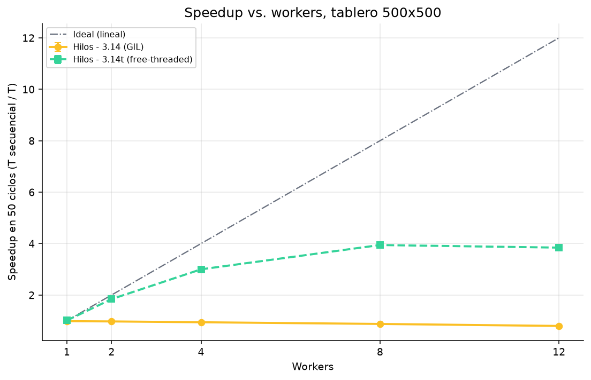
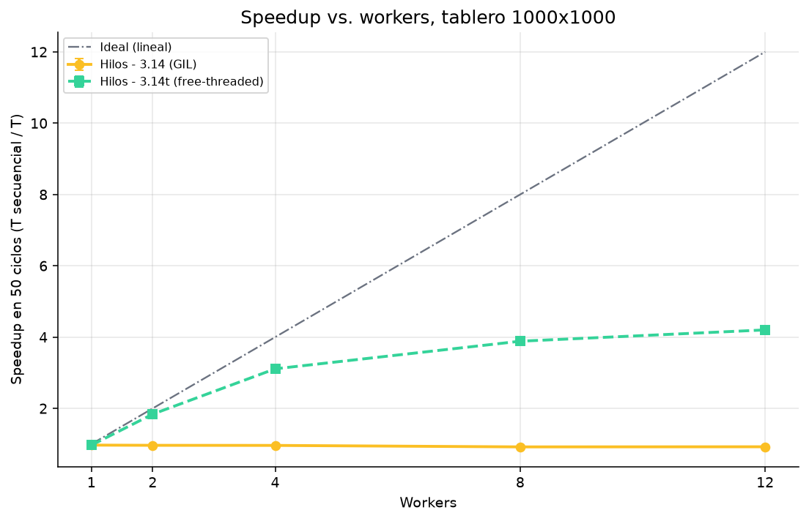
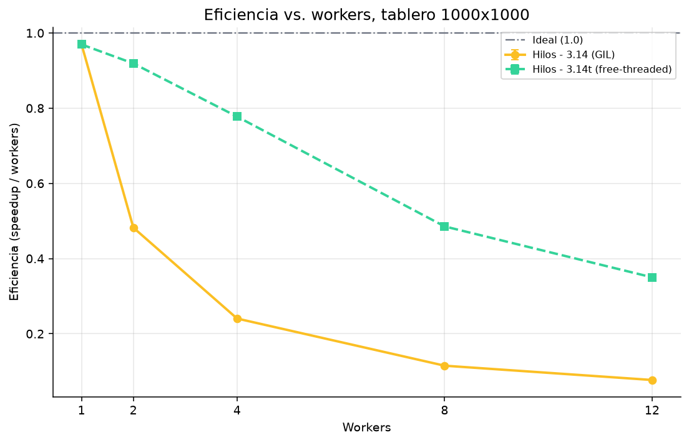
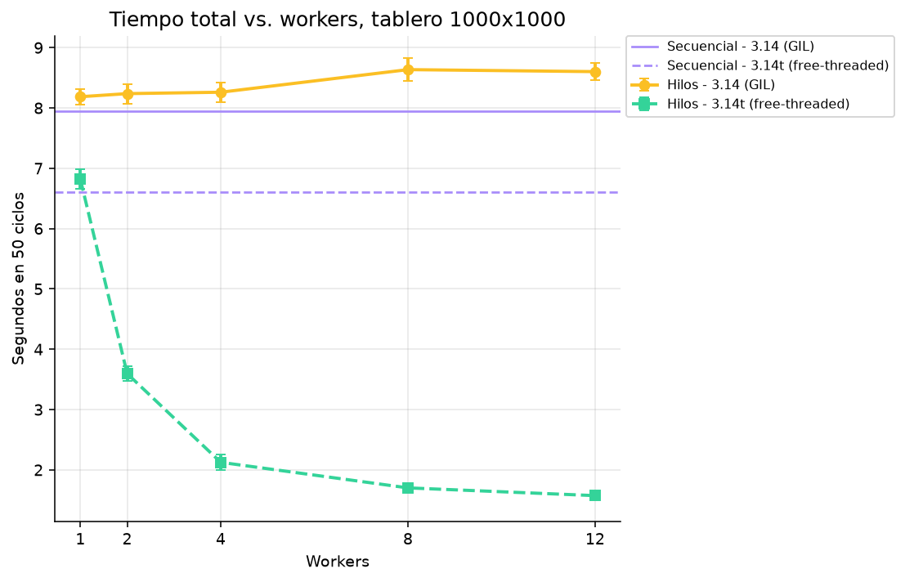
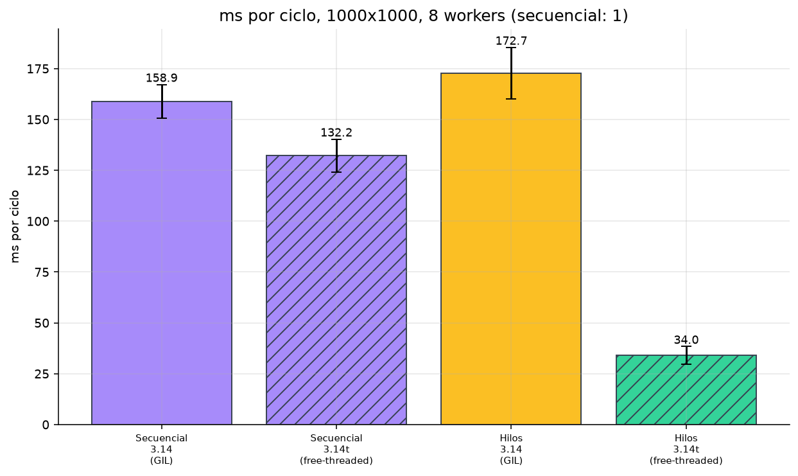
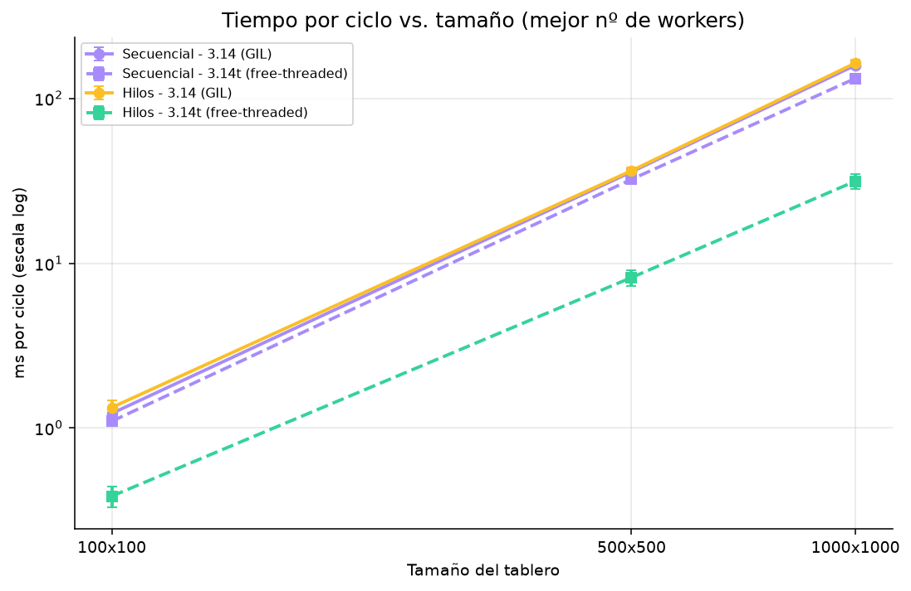
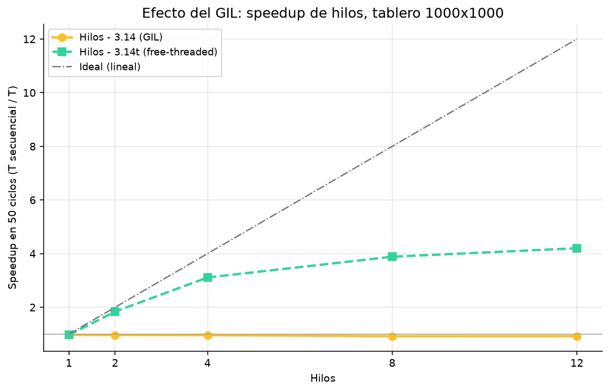

# Informe: Juego de la Vida en paralelo (hilos con y sin GIL)

## 1. Objetivo

Implementar el Juego de la Vida de Conway en una versión secuencial (referencia) y otra paralela con hilos, y medir cuánto se gana al paralelizar en tableros de 100x100, 500x500 y 1000x1000 con 1, 2, 4, 8 y 12 hilos. Como en Python la ganancia de los hilos depende del GIL, la comparación central es CPython 3.14 con GIL contra CPython 3.14t (free-threaded) con `-X gil=0`.

## 2. Implementación

### 2.1 Reglas y kernel común

Las dos versiones usan el mismo kernel (`life/core.py`, función `step_rows`): tablero como lista de listas de 0/1, bordes muertos y regla B3/S23 (una célula viva sobrevive con 2 o 3 vecinos; una muerta nace con exactamente 3). `step_rows(grid, rows, cols, r0, r1)` calcula solo las filas `[r0, r1)` de la siguiente generación leyendo el tablero actual, y devuelve las filas nuevas, cuántas células cambiaron y cuántas quedaron vivas. Lo único que cambia entre versiones es cómo se reparten las filas.

- **Secuencial** (`Engine`): una sola llamada a `step_rows` sobre todas las filas.
- **Hilos** (`ThreadEngine`): hilos persistentes sincronizados con `threading.Barrier`. Todos leen el mismo tablero (memoria compartida, solo lectura) y cada uno calcula su bloque de filas. Al final de la generación el hilo principal concatena los bloques.

### 2.2 Estrategia de paralelización

**División por bloques de filas contiguas.** `split_rows(rows, n)` reparte las filas en `n` bloques lo más parejos posible (si no se dividen exacto, los primeros bloques llevan una fila de más). Se eligieron filas y no columnas o bloques 2D porque el tablero es una lista de filas: cada worker recorre filas completas, la unión final es una concatenación y cada bloque solo tiene dos fronteras (arriba y abajo).

```
Tablero de 1000 filas, 4 workers (split_rows)

  fila 0    +-----------------------+
            | bloque 0 (0..249)     |  <- worker 0
  fila 250  +-----------------------+
            | bloque 1 (250..499)   |  <- worker 1
  fila 500  +-----------------------+
            | bloque 2 (500..749)   |  <- worker 2
  fila 750  +-----------------------+
            | bloque 3 (750..999)   |  <- worker 3
            +-----------------------+

Los 4 leen el mismo tablero (memoria compartida).
```

**Sincronización: doble buffer y barrera.** Una generación se calcula siempre a partir de la anterior completa, así que nadie escribe sobre el tablero que se está leyendo: cada worker produce filas nuevas en su propia lista y el tablero viejo solo se reemplaza cuando todos terminaron. `ThreadEngine` usa una `Barrier(workers + 1)` (los workers más el hilo principal) que se cruza dos veces por generación: la primera da la orden de empezar y la segunda garantiza que todos terminaron antes de unir los bloques.

### 2.3 Interfaz gráfica

El paquete `gui/` (customtkinter) simula el juego con dos motores sobre el mismo tablero, uno secuencial y uno paralelo con el número de hilos elegido. Los tamaños (100x100, 500x500, 1000x1000) y los workers (1, 2, 4, 8, 12) son los del benchmark. Los tableros se ven a escala real, con zoom con la rueda del mouse, desplazamiento por scrollbars o arrastre con el botón central, y ambos tableros muestran siempre la misma zona. En cada generación corre primero el secuencial y luego el paralelo, y se comparan los tableros; si difieren, la simulación se detiene con un error. También permite pintar con clic, colocar patrones clásicos (glider, pulsar, cañón de Gosper), generar tableros aleatorios y cambiar el retardo.

La GUI tiene un botón **"Correr X ciclos"** (50 por defecto) que corre el secuencial y el paralelo por separado, y muestra los totales, el promedio por ciclo ± desviación y los dos speedups (por ciclo y en X ciclos). Está pensado para la sustentación, porque reproduce en vivo una versión simplificada de la medición del benchmark (1 ciclo de calentamiento y una sola corrida, sin repeticiones). Aun así, la referencia para el informe es el paquete `benchmark`: la GUI comparte CPU con el dibujo y con el hilo de Tk.

## 3. Desafíos de la implementación paralela

- **Condiciones de carrera al actualizar el tablero.** Si cada hilo escribiera en el mismo tablero que los demás leen, un hilo podría ver vecinos ya actualizados a la generación siguiente y el resultado dependería del orden de ejecución. Se resolvió con doble buffer: el tablero actual es de solo lectura durante la generación y cada worker escribe en sus propias filas nuevas, por lo que no hace falta ningún lock sobre las células.
- **Resultados parciales sin locks.** Cada hilo guarda su resultado en `self.parts[t]`, una posición distinta de una lista preasignada; ningún par de hilos escribe en la misma posición y el hilo principal solo lee `parts` después de la segunda barrera, así que tampoco hace falta un mutex.
- **Sincronización entre generaciones.** El hilo principal no puede unir los bloques ni empezar la generación siguiente hasta que todos terminen. Con `join` habría que crear hilos nuevos en cada generación; con la barrera los hilos son persistentes y solo esperan. El costo es que cada generación espera al hilo más lento.
- **Errores y bloqueos.** Si un hilo falla, los demás quedarían esperando en la barrera para siempre. El hilo que falla guarda la excepción y llama a `barrier.abort()`, lo que despierta a todos con `BrokenBarrierError`; el hilo principal relanza el error original.
- **El GIL.** En CPython normal el código es correcto con hilos pero no se acelera, porque solo un hilo ejecuta bytecode a la vez (sección 6.1). Para medir paralelismo real hizo falta el build free-threaded 3.14t con `-X gil=0`.
- **Validación.** El benchmark compara el hash blake2b del tablero final de cada caso con el del secuencial (`valid`), y `python -m life.check` compara los motores con una implementación de referencia. Los 36 casos medidos dieron `valid = true`.

## 4. Entorno

**Hardware.** Intel Core i5-12450H (12th Gen), 12 CPU lógicas, 15 GiB de RAM. Son 8 núcleos físicos con arquitectura híbrida: 4 núcleos de rendimiento (P) con SMT (CPU 0 a 7, hasta 4.4 GHz) y 4 núcleos de eficiencia (E, CPU 8 a 11, sin SMT, hasta 3.3 GHz). Las 12 CPU lógicas no equivalen a 12 núcleos, por lo que el speedup máximo con 12 workers queda bastante por debajo de 12.

**Intérpretes.**

| Etiqueta | Versión | GIL |
|---|---|---|
| 3.14 (GIL) | 3.14.8, build normal (`/usr/bin/python3`) | activo |
| 3.14t (free-threaded) | 3.14.7, build free-threaded, `-X gil=0` | desactivado |

Son dos builds distintos (el de Arch y el de python-build-standalone instalado con uv), así que las diferencias del secuencial entre intérpretes (p. ej. 158.9 contra 132.2 ms/ciclo en 1000x1000) no se deben solo al GIL; por eso el speedup principal se calcula contra el secuencial del mismo intérprete.

## 5. Metodología

### 5.1 Qué se mide

Cada caso es una combinación de intérprete, tamaño, modo (secuencial o hilos) y número de hilos. Se corren **50 ciclos por repetición y 10 repeticiones**, tras **2 ciclos de calentamiento** (warmup) que se descartan, para que arranque de hilos, cachés y asignación de memoria no contaminen las muestras. El tablero es aleatorio con semilla 42 y densidad 0.3. Antes de reportar un caso se compara el hash del tablero final con el del secuencial; todos coinciden.

**Medición poco invasiva.** `life/cronometro.py` (`medir_ciclos`) cronometra desde fuera cada llamada a `engine.advance()` con `time.perf_counter()`. Los motores (`Engine`, `ThreadEngine`) no contienen ningún código de medición, de modo que el tiempo medido es el del cálculo de la generación tal como lo ejecutaría cualquier usuario del motor. No entran I/O, dibujo ni la construcción del motor (el `setup_s` se guarda aparte).

### 5.2 Métricas

Sea `t_{r,c}` el tiempo del ciclo `c` (de 1 a 50) en la repetición `r` (de 1 a 10), y `T_r = sum_c t_{r,c}` el tiempo total de la repetición `r`.

- **Tiempo promedio por ciclo:** `ciclo_prom = (1/500) * sum_{r,c} t_{r,c}`, con desviación estándar muestral sobre las 500 muestras individuales: `ciclo_std = sqrt( sum (t_{r,c} - ciclo_prom)^2 / 499 )`. Se calcula igual para el secuencial y para el paralelo.
- **Tiempo total en 50 ciclos:** `total_prom = (1/10) * sum_r T_r`, con desviación estándar muestral sobre las 10 repeticiones: `total_std = sqrt( sum (T_r - total_prom)^2 / 9 )`.
- **Speedup por ciclo:** `S_ciclo = ciclo_prom_seq / ciclo_prom_par`.
- **Speedup en 50 ciclos:** `S_total = total_prom_seq / total_prom_par`.
- **Eficiencia:** `E = S_total / p`, con `p` el número de hilos.
- **Speedup global:** `S_global = total_prom_seq(3.14 con GIL) / total_prom(caso)`. Es el speedup de cada caso, incluido el free-threaded, contra el secuencial con GIL, que es la línea base del benchmark.

Como el total es la suma de los ciclos, `S_ciclo` y `S_total` coinciden en las cifras redondeadas; se reportan ambos porque el enunciado los pide por separado y porque la desviación del ciclo individual (500 muestras) y la del total (10 muestras) cuentan cosas distintas: variabilidad de un ciclo contra variabilidad entre corridas.

## 6. Resultados

Datos: `results/bench-parcial.json` y `results/bench-parcial.csv` (36 casos, todos válidos). Todas las cifras de las tablas salen de esos archivos. El speedup es siempre contra el secuencial del mismo intérprete, salvo la última columna. Tiempo por ciclo en ms; total de 50 ciclos en s.

### 6.1 Tablero 100x100

| Intérprete | Modo | Hilos | ms/ciclo ± std | Total (s) ± std | Speedup ciclo | Speedup 50 ciclos | Eficiencia | Speedup global |
|---|---|---:|---:|---:|---:|---:|---:|---:|
| 3.14 (GIL) | Secuencial | 1 | 1.225 ± 0.067 | 0.061 ± 0.000 | 1.00 | 1.00 | 1.00 | 1.00 |
| 3.14 (GIL) | Hilos | 1 | 1.332 ± 0.144 | 0.067 ± 0.002 | 0.92 | 0.92 | 0.92 | 0.92 |
| 3.14 (GIL) | Hilos | 2 | 1.494 ± 0.197 | 0.075 ± 0.004 | 0.82 | 0.82 | 0.41 | 0.82 |
| 3.14 (GIL) | Hilos | 4 | 1.847 ± 0.403 | 0.092 ± 0.008 | 0.66 | 0.66 | 0.17 | 0.66 |
| 3.14 (GIL) | Hilos | 8 | 3.486 ± 1.039 | 0.174 ± 0.040 | 0.35 | 0.35 | 0.04 | 0.35 |
| 3.14 (GIL) | Hilos | 12 | 4.283 ± 0.852 | 0.214 ± 0.024 | 0.29 | 0.29 | 0.02 | 0.29 |
| 3.14t (free-threaded) | Secuencial | 1 | 1.099 ± 0.064 | 0.055 ± 0.001 | 1.00 | 1.00 | 1.00 | 1.12 |
| 3.14t (free-threaded) | Hilos | 1 | 1.253 ± 0.181 | 0.063 ± 0.002 | 0.88 | 0.88 | 0.88 | 0.98 |
| 3.14t (free-threaded) | Hilos | 2 | 0.818 ± 0.241 | 0.041 ± 0.005 | 1.34 | 1.34 | 0.67 | 1.50 |
| 3.14t (free-threaded) | Hilos | 4 | 0.521 ± 0.151 | 0.026 ± 0.004 | 2.11 | 2.11 | 0.53 | 2.35 |
| 3.14t (free-threaded) | Hilos | 8 | 0.386 ± 0.054 | 0.019 ± 0.000 | 2.85 | 2.85 | 0.36 | 3.17 |
| 3.14t (free-threaded) | Hilos | 12 | 0.499 ± 0.139 | 0.025 ± 0.001 | 2.20 | 2.20 | 0.18 | 2.45 |

### 6.2 Tablero 500x500

| Intérprete | Modo | Hilos | ms/ciclo ± std | Total (s) ± std | Speedup ciclo | Speedup 50 ciclos | Eficiencia | Speedup global |
|---|---|---:|---:|---:|---:|---:|---:|---:|
| 3.14 (GIL) | Secuencial | 1 | 35.800 ± 1.343 | 1.790 ± 0.021 | 1.00 | 1.00 | 1.00 | 1.00 |
| 3.14 (GIL) | Hilos | 1 | 36.428 ± 1.631 | 1.821 ± 0.017 | 0.98 | 0.98 | 0.98 | 0.98 |
| 3.14 (GIL) | Hilos | 2 | 36.810 ± 2.100 | 1.841 ± 0.016 | 0.97 | 0.97 | 0.49 | 0.97 |
| 3.14 (GIL) | Hilos | 4 | 38.053 ± 2.247 | 1.903 ± 0.016 | 0.94 | 0.94 | 0.24 | 0.94 |
| 3.14 (GIL) | Hilos | 8 | 40.910 ± 2.977 | 2.046 ± 0.019 | 0.88 | 0.88 | 0.11 | 0.88 |
| 3.14 (GIL) | Hilos | 12 | 44.931 ± 4.365 | 2.247 ± 0.070 | 0.80 | 0.80 | 0.07 | 0.80 |
| 3.14t (free-threaded) | Secuencial | 1 | 32.270 ± 2.048 | 1.614 ± 0.051 | 1.00 | 1.00 | 1.00 | 1.11 |
| 3.14t (free-threaded) | Hilos | 1 | 31.946 ± 2.031 | 1.597 ± 0.031 | 1.01 | 1.01 | 1.01 | 1.12 |
| 3.14t (free-threaded) | Hilos | 2 | 17.533 ± 2.151 | 0.877 ± 0.040 | 1.84 | 1.84 | 0.92 | 2.04 |
| 3.14t (free-threaded) | Hilos | 4 | 10.760 ± 2.433 | 0.538 ± 0.075 | 3.00 | 3.00 | 0.75 | 3.33 |
| 3.14t (free-threaded) | Hilos | 8 | 8.183 ± 0.880 | 0.409 ± 0.012 | 3.94 | 3.94 | 0.49 | 4.37 |
| 3.14t (free-threaded) | Hilos | 12 | 8.397 ± 2.093 | 0.420 ± 0.059 | 3.84 | 3.84 | 0.32 | 4.26 |



### 6.3 Tablero 1000x1000

| Intérprete | Modo | Hilos | ms/ciclo ± std | Total (s) ± std | Speedup ciclo | Speedup 50 ciclos | Eficiencia | Speedup global |
|---|---|---:|---:|---:|---:|---:|---:|---:|
| 3.14 (GIL) | Secuencial | 1 | 158.889 ± 8.264 | 7.945 ± 0.174 | 1.00 | 1.00 | 1.00 | 1.00 |
| 3.14 (GIL) | Hilos | 1 | 163.723 ± 8.660 | 8.186 ± 0.130 | 0.97 | 0.97 | 0.97 | 0.97 |
| 3.14 (GIL) | Hilos | 2 | 164.752 ± 11.581 | 8.238 ± 0.163 | 0.96 | 0.96 | 0.48 | 0.96 |
| 3.14 (GIL) | Hilos | 4 | 165.215 ± 10.840 | 8.261 ± 0.165 | 0.96 | 0.96 | 0.24 | 0.96 |
| 3.14 (GIL) | Hilos | 8 | 172.707 ± 12.689 | 8.635 ± 0.194 | 0.92 | 0.92 | 0.11 | 0.92 |
| 3.14 (GIL) | Hilos | 12 | 172.044 ± 11.132 | 8.602 ± 0.145 | 0.92 | 0.92 | 0.08 | 0.92 |
| 3.14t (free-threaded) | Secuencial | 1 | 132.198 ± 8.093 | 6.610 ± 0.147 | 1.00 | 1.00 | 1.00 | 1.20 |
| 3.14t (free-threaded) | Hilos | 1 | 136.344 ± 7.467 | 6.817 ± 0.163 | 0.97 | 0.97 | 0.97 | 1.17 |
| 3.14t (free-threaded) | Hilos | 2 | 71.919 ± 6.162 | 3.596 ± 0.118 | 1.84 | 1.84 | 0.92 | 2.21 |
| 3.14t (free-threaded) | Hilos | 4 | 42.504 ± 4.810 | 2.125 ± 0.124 | 3.11 | 3.11 | 0.78 | 3.74 |
| 3.14t (free-threaded) | Hilos | 8 | 34.033 ± 4.315 | 1.702 ± 0.073 | 3.88 | 3.88 | 0.49 | 4.67 |
| 3.14t (free-threaded) | Hilos | 12 | 31.465 ± 3.336 | 1.573 ± 0.060 | 4.20 | 4.20 | 0.35 | 5.05 |









### 6.4 Tiempo contra tamaño



El tiempo secuencial crece aproximadamente lineal en el número de células: con GIL, de 1.23 ms (10 000 células) a 35.8 ms (250 000) y 158.9 ms (1 000 000). Pasar de 100x100 a 1000x1000 multiplica las células por 100 y el tiempo por unos 130.

### 6.5 Efecto del GIL



## 7. Análisis

### 7.1 Con GIL los hilos no ayudan

Con 3.14 normal, ninguna configuración de hilos supera 1x. En 1000x1000 el speedup se queda entre 0.92x y 0.97x; en 500x500 baja de 0.97x con 2 hilos a 0.80x con 12; y en 100x100 llega a 0.29x con 12 hilos (4.28 ms por ciclo contra 1.23 ms secuencial). Con el GIL solo un hilo ejecuta bytecode a la vez, así que el cálculo no avanza más rápido y encima se paga el cambio de hilo y la espera en la barrera en cada generación. El empeoramiento crece con el número de hilos y es mayor en tableros pequeños, donde cada generación hace poco trabajo entre sincronizaciones. También sube la desviación (en 100x100 con 8 hilos, ± 1.04 ms sobre 3.49 ms).

### 7.2 Sin GIL los hilos escalan

Con 3.14t y `-X gil=0` el mismo código, sin cambios, llega a **4.20x en 1000x1000 con 12 hilos** (de 6.61 a 1.57 s en 50 ciclos) y a **3.94x en 500x500 con 8 hilos**. En 1000x1000 con 2 y 4 hilos el speedup es 1.84x y 3.11x (eficiencias 0.92 y 0.78). Contra el secuencial con GIL, el mejor caso llega a 5.05x (speedup global), porque suma el efecto de paralelizar y el del build más rápido.

La curva se aplana pasados 4 a 8 hilos: en 500x500, 12 hilos (3.84x) no mejoran a 8 (3.94x), y la eficiencia cae de 0.78 con 4 hilos a 0.35 con 12 en 1000x1000. Coincide con el hardware: más allá de 4 workers empiezan a ocuparse hilos SMT y núcleos E, que aportan menos que un núcleo P completo.

### 7.3 Tamaño del problema: en 100x100 domina el overhead

En 100x100 un ciclo secuencial cuesta 1.1 a 1.2 ms, del mismo orden que la sincronización por barrera. Sin GIL el mejor resultado es 2.85x con 8 hilos y con 12 hilos baja a 2.20x: cada hilo recibe solo unas 8 filas y la barrera pesa más que el cálculo. Con GIL el overhead lleva directamente a 0.29x. En 500x500 y 1000x1000 el trabajo por generación amortiza la sincronización y el speedup con 8 hilos es casi idéntico (3.94x y 3.88x), lo que indica que desde 500x500 el límite ya no es el tamaño del tablero sino la parte serial y el hardware. Solo con 12 hilos el tablero grande sigue ganando (4.20x contra 3.84x).

### 7.4 Ley de Amdahl

Con `S = 1 / (s + (1 - s)/p)`, la fracción serial efectiva se despeja como `s = (1/S - 1/p) / (1 - 1/p)`, usando `S_total` de los hilos con 3.14t (sin GIL). El valor mezcla la parte realmente secuencial con todo lo que impide escalar (SMT, núcleos E, memoria, espera en la barrera), por lo que es una estimación efectiva.

| Tablero | p | Speedup | s estimada | Speedup máximo (1/s) |
|---|---:|---:|---:|---:|
| 500x500 | 2 | 1.84 | 0.09 | 11.5 |
| 500x500 | 4 | 3.00 | 0.11 | 9.0 |
| 500x500 | 8 | 3.94 | 0.15 | 6.8 |
| 500x500 | 12 | 3.84 | 0.19 | 5.2 |
| 1000x1000 | 2 | 1.84 | 0.09 | 11.4 |
| 1000x1000 | 4 | 3.11 | 0.10 | 10.5 |
| 1000x1000 | 8 | 3.88 | 0.15 | 6.6 |
| 1000x1000 | 12 | 4.20 | 0.17 | 5.9 |

Con 2 a 4 hilos `s` está entre 0.09 y 0.11; con 8 a 12 sube a 0.15-0.19, lo que sugiere que el techo en esta máquina es de unas 6x. El aumento de `s` con `p` indica que no es solo parte serial del programa (que sería constante), sino también un hardware que rinde menos por hilo adicional. La unión de bloques y la suma de contadores del hilo principal son proporcionales al número de filas, no de células, así que son una parte pequeña; la espera al worker más lento y la heterogeneidad P/E son hipótesis plausibles que este experimento no separó.

## 8. Conclusiones

- **El paralelismo es efectivo en este juego**, porque cada célula de una generación se calcula de forma independiente a partir de la anterior: basta dividir en bloques de filas y sincronizar entre generaciones.
- **Hilos con GIL (3.14 normal):** no sirven para este cálculo en Python puro. Nunca superan 1x y empeoran con más hilos (0.92x en 1000x1000 y 0.80x en 500x500 con 12 hilos, 0.29x en 100x100).
- **Hilos sin GIL (3.14t, `-X gil=0`):** mejoran en todos los tamaños sin cambiar el código: 4.20x en 1000x1000 con 12 hilos, 3.94x en 500x500 con 8 y 2.85x en 100x100 con 8.
- **Tableros pequeños:** en 100x100 el overhead de sincronización domina; con GIL conviene el secuencial y sin GIL no pasar de 8 hilos.
- **Límite práctico:** el speedup se satura en torno a 4x por la fracción serial efectiva (0.15-0.19 con 8 a 12 hilos) y por la CPU híbrida, lejos del ideal lineal de 12x.
- **Alcance:** las cifras son de una sola máquina y una sola corrida completa; la CPU es híbrida y no se fijó afinidad, así que diferencias de 10-20 % entre casos cercanos (p. ej. 8 contra 12 hilos) no deben tomarse como significativas. Las desviaciones de las tablas permiten juzgarlo.

## 9. Cómo reproducir

Verificación de correctitud de los motores:

```
.venv/bin/python -m life.check
```

Benchmark completo (3.14 con GIL y 3.14t con `-X gil=0`; tamaños, workers, 50 ciclos y 10 repeticiones por defecto). Escribe JSON y CSV en `results/`. Flags útiles: `--ciclos N`, `--reps N`, `--quick` (prueba rápida), `--sizes`, `--workers`, `--out`.

```
python3 -m benchmark --out results/bench-parcial.json
python3 -m benchmark --quick
python3 -m benchmark --ciclos 50 --reps 10
```

Gráficas (el `--no-project` evita que `uv` recree el `.venv` del proyecto); los PNG quedan en `results/graficas/`:

```
uv run --no-project --with matplotlib python scripts/graficas.py results/bench-parcial.json
```

Interfaz gráfica (usa el `.venv` del proyecto, CPython 3.14t free-threaded):

```
.venv/bin/python -m gui
```
